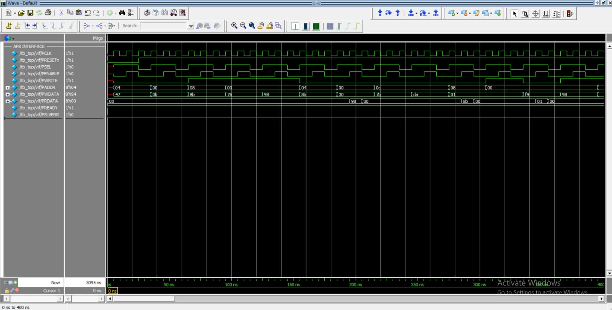

# APB Verification Using UVM

## Project Overview
This project verifies an Advanced Peripheral Bus (APB) slave using SystemVerilog and the Universal Verification Methodology (UVM). The testbench was simulated using QuestaSim 10.7c with UVM 1.1d.

## Design Features
- APB slave with four memory-mapped 8-bit registers
- Register addresses: `0x00`, `0x04`, `0x08`, and `0x0C`
- Read and write transactions
- Ready and error response signals

## UVM Testbench Architecture
- **Sequence Item:** Defines randomized APB transactions.
- **Sequence:** Generates 100 transactions.
- **Sequencer:** Sends transactions to the driver.
- **Driver:** Drives APB signals through the virtual interface.
- **Monitor:** Observes completed APB transfers.
- **Scoreboard:** Compares read data with the reference model.
- **Functional Coverage:** Tracks the read/write and address bins defined in the covergroup.
- **Agent and Environment:** Connect the verification components.
- **Test:** Starts the sequence and manages the simulation.

## Simulation Results

| Metric | Result |
|---|---:|
| Transactions observed | 100 |
| Scoreboard PASS count | 54 |
| Scoreboard FAIL count | 0 |
| Functional coverage | 100% |
| UVM warnings | 0 |
| UVM errors | 0 |
| UVM fatal errors | 0 |

**Note:** The scoreboard PASS count represents successful read comparisons; writes are logged separately. The 100% functional coverage applies to the covergroup bins defined in this testbench, not every possible APB scenario.

## Simulation Waveform

## Tools Used
- SystemVerilog
- UVM 1.1d
- QuestaSim 10.7c

## Repository Structure
- `rtl/` — APB slave RTL
- `tb/` — UVM testbench components
- `simulation/` — Simulation files and logs
- `APB_Verification_UVM_waveform.jpeg` — Simulation waveform

## Future Improvements
- Add protocol assertions.
- Test invalid-address and error-response scenarios.
- Extend coverage for additional APB protocol scenarios.

[**View APB UVM Waveform**](APB_Verification_UVM_waveform.jpeg)

